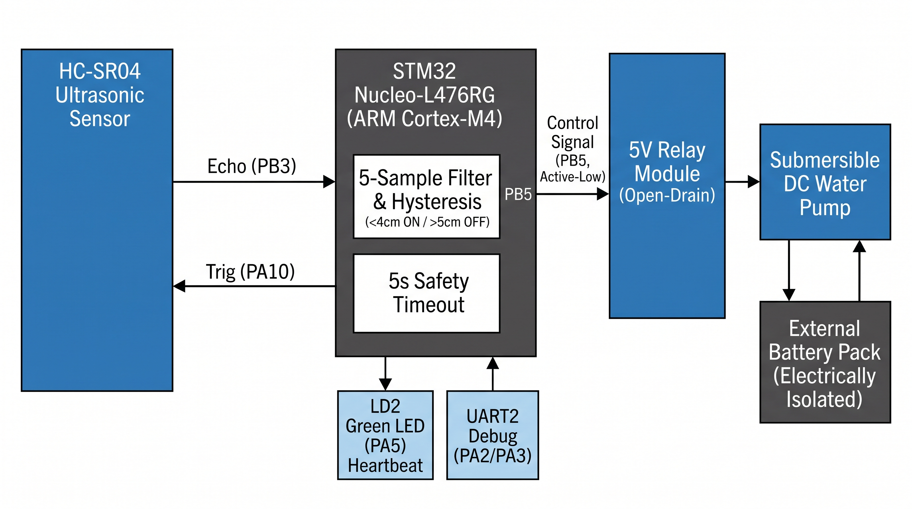
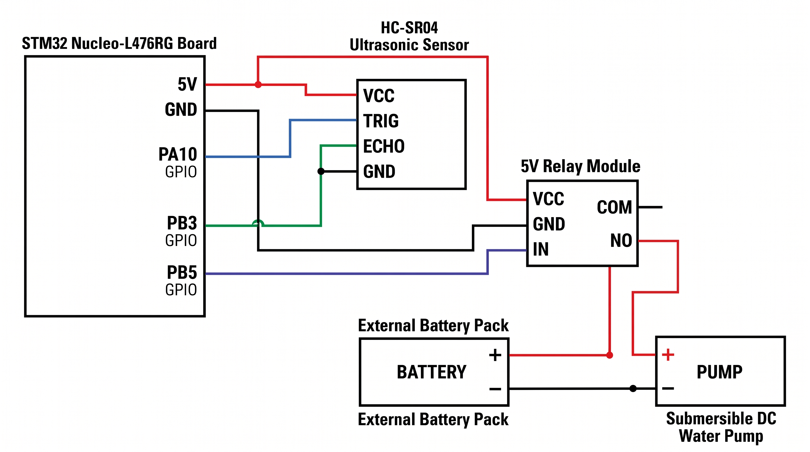
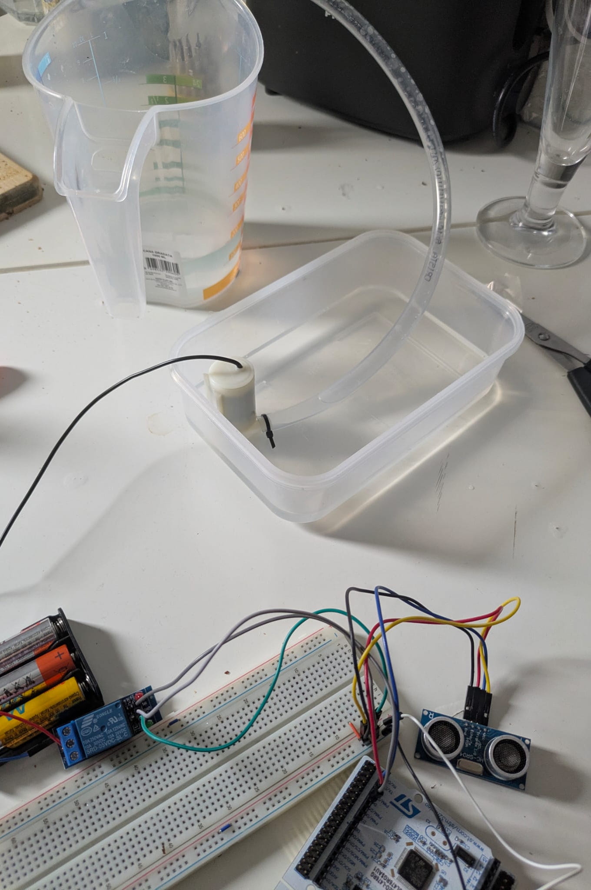
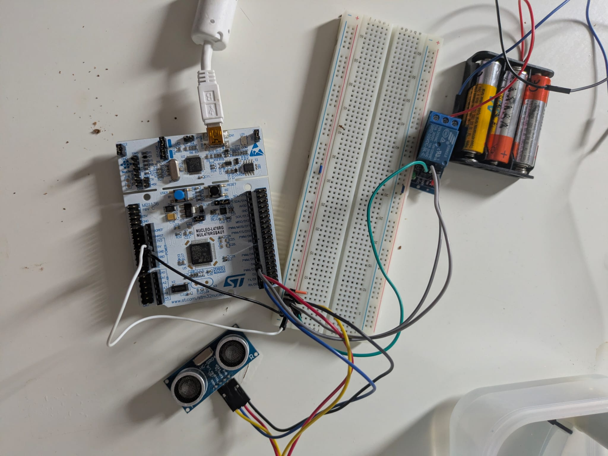

# Automated Dam Water Level Control System on STM32

An embedded closed-loop water level monitoring and automated drainage system built in **C** for an **STM32 Nucleo-L476RG** microcontroller. The system continuously measures the water level inside a dam basin using an ultrasonic sensor and automatically triggers a relay-controlled submersible pump to prevent overflow, incorporating hysteresis and hardware safety timeouts.

## 📌 Project Overview
This prototype simulates automated floodgate/drainage control in a hydroelectric dam environment:
- **Real-Time Level Sensing:** Measures water surface distance using an HC-SR04 ultrasonic sensor with microsecond-level hardware cycle counting (`DWT->CYCCNT`) and a 5-sample moving average filter to eliminate noise and water ripples.
- **Automated Pump Control with Hysteresis:** Activates an active-low 5V relay module to power a submersible drainage pump when the water distance drops below **4 cm** (critical high water level) and shuts it off once the water recedes past **5 cm** (preventing rapid relay chattering).
- **Failsafe Protection:** Includes a built-in **5-second maximum continuous run timeout** followed by a **3-second cooldown** to protect the pump from dry-running or sensor obstruction faults.

## 📐 System Architecture & Wiring
### System Block Diagram

### Electrical Wiring Schematic

## 🛠️ Hardware Setup
- **Microcontroller:** STM32 Nucleo-L476RG (ARM Cortex-M4 @ 80 MHz)
- **Sensor:** HC-SR04 Ultrasonic Distance Sensor
- **Actuator & Power Switching:** 5V Single-Channel Relay Module (configured in Open-Drain mode, active-low)
- **Load:** Submersible DC Water Pump powered via external battery pack (electrically isolated from MCU logic)
- **Status Indicator:** On-board Green User LED (`LD2`) toggling on each measurement cycle as a system heartbeat

### Pin Mapping (`baraj1.ioc`)
| Component | Signal / Function | STM32 Pin | Configuration |
| :--- | :--- | :--- | :--- |
| **HC-SR04 Trig** | Ultrasonic Trigger Pulse | `PA10` | `GPIO_Output` (Push-Pull) |
| **HC-SR04 Echo** | Echo Return Pulse | `PB3` | `GPIO_Input` |
| **Relay Module** | Pump Control Signal | `PB5` | `GPIO_Output` (Open-Drain, Active-Low) |
| **Status LED (LD2)** | System Heartbeat | `PA5` | `GPIO_Output` (Push-Pull) |
| **UART2 (Debug)** | Serial Telemetry (`115200 bps`) | `PA2` (TX) / `PA3` (RX) | `USART2` Asynchronous |

## 💻 Firmware Architecture
Developed in **C** using **STM32CubeIDE** and the **STM32Cube HAL** library:
- **High-Precision Timing (`DWT`):** Utilizes the ARM Cortex-M4 Data Watchpoint and Trace cycle counter (`DWT->CYCCNT`) for accurate microsecond pulse generation (`10 µs` trigger) and echo pulse width measurement without blocking hardware timers.
- **Noise Filtering (`masoara_media`):** Samples 5 consecutive readings (`0–400 cm` valid range) with a `10 ms` interval between bursts and computes the filtered average.
- **State & Safety Loop:** Tracks pump state (`pompa_este_pornita`) and runtime timestamps (`HAL_GetTick()`) to enforce the 5-second safety cutoff and hysteresis thresholds (`< 4 cm` ON, `> 5 cm` OFF).

## ⚙️ Tools & Technologies Used
- **Microcontroller & IDE:** STM32CubeIDE, STM32CubeMX (`baraj1.ioc`)
- **Language & Libraries:** Embedded C, STM32 HAL Drivers, CMSIS Core (`DWT`)
- **Clock Configuration:** 80 MHz SYSCLK via HSI + PLL

## 📸 Hardware Prototype
| Basin & Submersible Pump Setup | STM32, Relay & Sensor Wiring |
| :---: | :---: |
|  |  |

## 🎥 Demo

https://github.com/user-attachments/assets/557e027b-1216-4f1e-ab6c-ef346fd3f153
